<a href="https://ensomg.com"></a>

<p align="center">
  <a href="https://ensomg.com"></a>
  <a href="https://github.com/ensomg/portfolio"></a>
</p>




## Run it locally

```bash
npm install
npm run dev
```

---

Built by [ensomg](https://ensomg.com).
